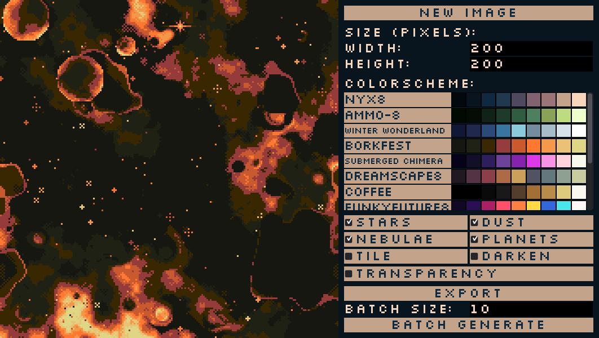

# PixelSpace

Create and export procedural, pixel-styled space backgrounds. PixelSpace is a small Godot app for generating customizable scenes with stars, dust, nebulae, and planets. Choose a color palette, set the output dimensions, and toggle visual layers to shape each image. Generate one image at a time or create a batch of randomized backgrounds. All with a live preview. 

## Screenshot

  

## Features

- Procedural nebulae and space dust
- Randomized stars and planets
- Multiple built-in color schemes
- Adjustable width and height from 100 to 3000 pixels
- Toggleable visual layers, background darkening, transparency, and tiling
- PNG export and batch generation (1-100 images)

## How to use

### Run the Windows build

Download and run [`build/BatchSpaceBackground.exe`](build/BatchSpaceBackground.exe).

### Run from the Godot project

1. Clone or download this repository.
2. Open the project in the Godot 3 editor.
3. Run the project (the main scene opens to the generator).

### Generate and export images

1. Click **new image** to generate a scene.
2. Set the desired **width** and **height** in pixels.
3. Select a color scheme and adjust the stars, dust, nebulae, planets, tile, darken, and transparency options.
4. Click **export** to save a PNG. Desktop builds save it in the project directory; the HTML5 build downloads it through the browser.
5. To generate several scenes, set **batch size** and click **Batch Generate**.

## License

The code is available under the [MIT License](LICENSE). Generated images may be used in games and other projects; the original project notice asks that they not be distributed or sold on their own.
